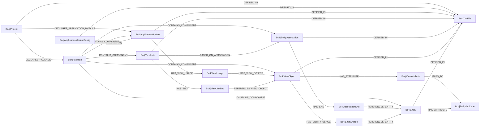

# Graph Model Reference

The plugin stores each BC4J definition as a typed node. Common component nodes have `name`, `qualifiedName`, and `sourceFile` properties, plus an outgoing `DEFINED_IN` relationship to the `Bc4jXmlFile` node. `qualifiedName` is derived from the definition's package path and `Name` unless the XML already provides a qualified name.

## Relationships

`MAPS_TO`, `REFERENCES_*`, `USES_VIEW_OBJECT`, `CONFIGURES`, `BASED_ON_ASSOCIATION`, `CONTAINS_COMPONENT`, and `DECLARES_APPLICATION_MODULE` are created by the packaged Cypher concepts. Run the corresponding `bc4j:*` concept before querying those edges.

## Node labels and properties

| Label | Meaning | Properties |
| --- | --- | --- |
| `Bc4jXmlFile` | Scanned BC4J XML-family file; extends jQAssistant's `XmlFileDescriptor`. | `pathInJar`, `bc4jRootElement`, inherited XML file properties |
| `Bc4jEntity` | Entity Object mapped to a table, view, or synonym. | `qualifiedName`, `tableName`, `dbObjectType`, `javaTypeFqn` |
| `Bc4jEntityAttribute` | Entity Object attribute and its database column mapping. | `name`, `columnName`, `tableName`, `javaType`, `columnType`, `sqlType`, `isNotNull`, `primaryKey`, `precision`, `scale`, `isUpdateable` |
| `Bc4jViewObject` | View Object query or entity-based projection. | `qualifiedName`, `javaTypeFqn`, `fromList`, `whereClause`, `sqlQuery`, `tableName`, `tableNames`, `tableNamesComplete` |
| `Bc4jEntityUsage` | Named Entity Object usage within a View Object. | `name`, `entityFqn`, `joinType` |
| `Bc4jViewAttribute` | View Object projection attribute. | `name`, `entityUsageName`, `entityAttributeName`, `javaType`, `columnName`, `aliasName`, `isPersistent`, `isSelected`, `isUpdateable`, `isNotNull`, `precision`, `scale` |
| `Bc4jEntityAssociation` | Relationship definition between Entity Objects. | `qualifiedName`, `sourceFile` |
| `Bc4jAssociationEnd` | One side of an Entity Association. | `name`, `ownerEntityFqn`, `cardinality`, `source`, `attributes`, `foreignKey`, `aggregation`, `isUpdateable` |
| `Bc4jViewLink` | Relationship definition between View Objects. | `qualifiedName`, `entityAssociationFqn`, `sourceFile` |
| `Bc4jViewLinkEnd` | One side of a ViewLink. | `name`, `ownerViewObjectFqn`, `cardinality`, `source`, `attributes`, `finderName`, `isUpdateable` |
| `Bc4jApplicationModule` | ApplicationModule definition and its data model. | `qualifiedName`, `javaTypeFqn`, `sourceFile` |
| `Bc4jViewUsage` | A named View Object instance in an ApplicationModule. | `name`, `viewObjectFqn` |
| `Bc4jApplicationModuleConfig` | One `.xcfg` runtime configuration entry. | `name`, `qualifiedName`, `applicationName`, `deployPlatform`, `jdbcName`, `poolProperties`, `databaseProperties` |
| `Bc4jProject` | `.jpx` project registry. | `name`, `qualifiedName`, `packageName`, `applicationModuleNames` |
| `Bc4jPackage` | A package registered by a JboProject. | `name`, `qualifiedName`, `entityPackage`, `viewObjectPackage`, `applicationModulePackage` |

Entity and View Object attributes are stored as separate nodes, preserving the declared column and type metadata. View Object attributes with `EntityUsage` and `EntityAttrName` are linked to Entity Attributes by `bc4j:ResolveViewAttributeMappings`.

## Table lineage semantics

- Entity Objects use `DBObjectName` as `tableName` and `DBObjectType` as `dbObjectType` (`table` is the default when the attribute is absent).
- Entity-based View Objects resolve every `EntityUsage`; their table names come from the referenced Entity Objects.
- Read-only/direct SQL View Objects use [JSqlParser 5.4](https://jsqlparser.github.io/JSqlParser/usage.html#find-table-names) on `FromList` or `SQLQuery`. `TablesNamesFinder` extracts sources from joins, nested queries, and set operations.
- `tableNames` is the set of discovered sources. `tableNamesComplete` is false when Entity Usages are unresolved, SQL cannot be parsed, or no source table can be inferred. The scalar `tableName` is populated only when exactly one complete source exists.
- Runtime connection strings and configuration values whose property names indicate credentials are not stored. The logical `JDBCName` and non-sensitive pool/database settings are retained.
